  <picture>
    <source media="(prefers-color-scheme: dark)" srcset="assets/banner-dark.svg">
    
  </picture>

<a href="README.md">English</a> &middot; <a href="README.zh-CN.md">中文</a> &middot; Lingua Latīna

---

## Artes

| Ambitus | Artes |
| --- | --- |
| Linguae | C, C++ (C++11 ad C++23), Go, TypeScript, Python, Rust, x86 ASM |
| Clientes et graphica | Qt6 et Qt6 proprie accommodatum (vendored), Unreal Engine 5, CEF extra scaenam reddens, DirectX 12, Vulkan, DirectComposition, Live2D Cubism |
| Protocolla et translatio | Designatio protocolli binarii proprii, TLS 1.3, QUIC, HTTP/3, WebRTC, AnyTLS, REALITY, obfs4, Hysteria2, Snowflake |
| Cryptographia | Normae Sinicae (SM2, SM3, SM4), postquantica (ML-KEM, ML-DSA, SLH-DSA), OPAQUE, MLS, HPKE, Noise, attestatio TPM 2.0, WebAuthn, ProVerif |
| Programmatio systematum et harenaria | Spatia nominum Linux, seccomp, cgroups, AppContainer, WebAssembly (Wasmtime), impedimenta contra purgationem et munitio programmatum, variantes VMP et tutela mutationis |
| Institutio modelorum | PyTorch, TRL, PEFT, LoRA, DPO, ablatio directionalis (Heretic, MPOA, ARA) |
| Inferentia modelorum | vLLM, TensorRT-LLM, Infinity, quantizatio modelorum, temperatio RoPE |
| Inquisitio et bases scientiae | RAGFlow, Elasticsearch, inquisitio mixta, reordinatio, golden set |
| Agentes | MCP, Letta, Claude Code, Codex |
| Retia | Itineratores programmatici, libratio oneris et transitus in defectu, aggregatio nexuum, VLAN, VXLAN, muri ignis (nftables), procuratio perspicua et distributio, conformatio fluxus et moderatio congestionis, DNS recursivum et auctoritativum, DNSSEC, servitia occulta Tor |
| Systemata et administratio | Linux, Docker, systemd, Ansible, Nginx, FRP, Proxmox Backup Server |
| Bases datorum | PostgreSQL, MySQL, SQLite, CouchDB, Elasticsearch, Valkey |
| Computatio scientifica | JupyterLab, Dask, REBOUND, MERCURY, VPLanet, ExoPlaSim, climlab |

## Principia Fabricationis

- Dignitatem, elegantiam et rectitudinem architecturae omni celeritati tradendi omnibusque postulatis anteponere soleo.
- In designando API primum ponere soleo, et qualitati fabricationis API et SDK primas partes tribuo.
- Semper in parte Dev-First sto; Sales-First, Consumer-First et Time-to-Market me non movent.
- Designationi nimiae non adversor, et praecipue odi YAGNI et KISS praetexta.
- Fail-Fast. Codex pactis declaratis confidit, examinatio ad fines fiduciae collocatur; ramos defensivos et omne genus codicis subsidiarii odi.
- Rationem programmatum quae levitatem et parvitatem elegantem sine modo sequitur non probo. Potius API et additamenta flexibilia sequor; compositio autem architecturae elegans ut vere fieri possit, abstractione inferiore valida et una opus est.
- Nulla programmata facio nisi quae meo gustui respondeant; nec fama fontis aperti, nec auxilium aliis, nec quaestus me tangunt.
- Electio verborum est decretum designationis. Nomen parum accuratum designatio parum accurata est.
- Utrum fons aperiatur necne, programmatoris est eligere. Fons apertus et fons clausus duae viae aequi pretii sunt, quarum utramvis eligere nulla explicatione eget. Coactioni morali nomine fontis aperti adversor.
- Retroversam machinationem iniussam et illicitam odi, neque probo eam specie fontis aperti aut communicationis indui.
- Cameram machinarum et computatra consociata mea habeo. De principatu datorum et programmatum meorum summe sollicita sum, itaque quae in loco exsequi possunt in nubem non transfero.

## Opera

### Suggesta et infrastructura

| Opus | Descriptio | Lingua | Licentia |
| --- | --- | --- | --- |
| [**Astra**](https://gitlab.rothmary.com/Astra/Public) | Planum DevOps unificatum et privatim sui iuris, quod administrationem operum programmaticorum et ministratorum in unum suggestum colligit. Clientes Qt, Unreal Engine et interretiales unum nucleum protocolli, permissionum et recognitionis communicant. | C/C++ | Propria (EULA) |
| [**Aevum**](https://gitlab.rothmary.com/Aevum) | Rete publicorum monumentorum verificabilium. Nucleus minimus et recognoscibilis protocolla applicationum, schemata datorum et cryptographiam ex monumentis in catena petit et in harenario exsequitur. Libro rationum BFT permissivo innititur. | Go, Rust, Solidity | MIT |

### Agentes

| Opus | Descriptio | Lingua | Licentia |
| --- | --- | --- | --- |
| [**Armillary**](https://gitlab.rothmary.com/Armillary) | Ambitus agentium in loco proprio, cum aditibus CLI, SDK et MCP, instrumentis insitis et subagentibus. Etiam ut SaaS instrui potest. | TypeScript | Propria (EULA) |
| [**Gestalt Mind**](https://gitlab.rothmary.com/Gestalt) | Automatio officii agentibus destinata: rationes, munera, greges, permissiones, plicae communes et scientia communis, cum epistulis et nuntiis. Quisque agens sessiones suas nativas servat. | Rust | Fons legibilis (RSL) |

### Contentum et commentarii

| Opus | Descriptio | Lingua | Licentia |
| --- | --- | --- | --- |
| [**Pandectae**](https://gitlab.rothmary.com/Pandectae) | Systema generale contenti: WordPress lingua Go denuo factum, conceptibus et datis congruens. Quilibet situs WordPress sine damno importari potest. | Go | Apache 2.0 |
| [**Eburnea**](https://gitlab.rothmary.com/Eburnea) | Ephemeris personalis in Pandectis denuo aedificata. | Go | Propria |
| [**Tabularium**](https://github.com/Violaria/Tabularium) | Ministrator proprius commentariis synchronizandis cum cryptatione ab extremo ad extremum, cum additamento Obsidian, commentariis in interrete, communicatione, missione ad Kindle et administratore AI. | TypeScript | MIT |
| [**Litterae Anonymae**](https://gitlab.rothmary.com/Litterae) | Arcula quaestionum anonymarum a me ipsa conservata: hospites sine inscriptione quaerunt, dominus situs publice respondet. | Ruby, TypeScript | MIT |

Omnia repositoria in instantia GitLab a me ipsa administrata hospitantur. Opera fontis aperti ibi fontem fortasse publicant; opera propria tantum producta perfecta et documenta edunt. Fons Tabularii etiam in GitHub publicatur.
