  <picture>
    <source media="(prefers-color-scheme: dark)" srcset="assets/banner-dark.svg">
    
  </picture>

English &middot; <a href="README.zh-CN.md">中文</a> &middot; <a href="README.la.md">Lingua Latīna</a>

---

## Values

### Engineering

- Architectural dignity comes before everything. Delivery speed and requirement-driven development both rank below the correctness of architectural design. Engineering must follow the grain of the architecture; I detest servile engineering that surrenders architectural dignity to closing tickets.
- Rather than patching the architecture or carving exceptions into it, I would sooner refactor it for the long term. My designs are API-first, and I care about the engineering quality of APIs and SDKs.
- I stand for developer-first. Customer- and market-first (sales-first) and consumer-first thinking do not interest me, and I equally detest the values of short-term delivery, rapid iteration and racing for a market window.
- I do not oppose over-design. I detest YAGNI and KISS being used as excuses to pass off ill-considered, under-abstracted, narrowly applicable code.
- I am an engineering purist, and I design and build only software that meets my own standards of code aesthetics. I dislike ingratiating user experience, and monetisation holds still less interest for me. Nor do I need to work to make money.
- I do not practise vibe coding, but I am not opposed to AI. All AI-assisted engineering should be governed by standards, and all generated code must be audited by human experts; at minimum, a human must review the test code.
- Digital sovereignty: my data stays under my own control, and whatever can run locally does not go to the cloud. I take a negative view of going all-in on cloud services; my own server room lacks neither hardware nor cluster capacity.

### Open Source

- I am not a zealot of the open-source movement.
- I oppose moral coercion in the name of open source. Whether to open-source should be the developer's freedom. Open source and closed source are two routes of equal worth, and choosing either requires no explanation or justification.
- I oppose unauthorised, unlawful reverse engineering, and I oppose still more the dressing up of theft as the spirit of open source or of internet sharing.
- I support free software, but the freedom I care about is the developer's freedom over their own work; the freedom of the user does not interest me.
- Security derives from design, implementation and audit. Open source does not imply security, and closed source does not imply insecurity.

## Projects

### Platforms and infrastructure

| Project | Description | Language | Licence |
| --- | --- | --- | --- |
| [**Astra**](https://gitlab.rothmary.com/Astra/Public) | A privately sovereign, unified DevOps plane that brings software engineering management and server operations onto one platform. Qt, Unreal Engine and web clients share one core of protocol, permissions and audit. | C/C++ | Proprietary (EULA) |
| [**Aevum**](https://gitlab.rothmary.com/Aevum) | A verifiable public record network. A minimal, auditable kernel fetches application protocols, data schemas and cryptographic suites from content-addressed on-chain records and runs them in a sandbox. Built on a permissioned BFT ledger. | Go, Rust, Solidity | MIT |

### Agents

| Project | Description | Language | Licence |
| --- | --- | --- | --- |
| [**Armillary**](https://gitlab.rothmary.com/Armillary) | An on-premises agent runtime with CLI, SDK and MCP entry points, built-in tools and sub-agents. Also deployable as SaaS. | TypeScript | Proprietary (EULA) |
| [**Gestalt Mind**](https://gitlab.rothmary.com/Gestalt) | Office automation for agents: accounts, positions, working groups, scoped permissions, shared files and common knowledge, with mail and notices. Each agent keeps its native sessions. | Rust | Source-available (RSL) |

### Content and notes

| Project | Description | Language | Licence |
| --- | --- | --- | --- |
| [**Pandectae**](https://gitlab.rothmary.com/Pandectae) | A general-purpose CMS: WordPress reimplemented in Go, compatible in concepts and data. Any WordPress site can be imported without loss. | Go | Apache 2.0 |
| [**Eburnea**](https://gitlab.rothmary.com/Eburnea) | A personal blog being rebuilt on Pandectae. | Go | Proprietary |
| [**Tabularium**](https://github.com/Violaria/Tabularium) | A self-hosted, end-to-end encrypted note synchronisation server with an Obsidian plug-in, web notes, sharing, Send to Kindle and an AI administrator. | TypeScript | MIT |
| [**Litterae Anonymae**](https://gitlab.rothmary.com/Litterae) | A self-maintained anonymous question box: visitors ask without registering and the site owner answers in public. | Ruby, TypeScript | MIT |

All repositories are hosted on a self-managed GitLab instance. Open-source projects may publish their source there; proprietary projects publish releases and documentation only. Tabularium's source is also public on GitHub.

## Technology

**Languages**: C, C++, Rust, Go, TypeScript, Python, x86 Assembly

## Organisation

Stardust Reverie Technology Co., Ltd.
