  

<a href="README.md">English</a> &middot; 中文 &middot; <a href="README.la.md">Lingua Latīna</a>

---

如果你想要在我的 GitHub 上关注我的工作，或者提 issue，遗憾的是，我很少关注 GitHub 上的消息，并且我的大部分项目工程都是在我的私人 GitLab 上。

## 工程价值观

- 我倾向于架构的尊严、优雅与正确性排在一切交付速度和需求之前。
- 我倾向于设计以 API 为先，我优先重视 API 与 SDK 的工程质量。
- 我向来站在 Dev-First 的立场，对 Sales-First、Consumer-First 和 Time-to-Market 没有兴趣。
- 我不反对过度设计，我尤其讨厌 YAGNI 和 KISS 的借口。
- Fail-Fast。我厌恶防御性分支和各类兜底代码。
- 我不认同软件一味追求轻量化/小而美的软件理念。我更倾向于API化/灵活插件化，而架构上的优雅组合要真正可行，前提是一个强有力的统一底层抽象。
- 我只做符合自己审美的软件，对于追求开源声誉、帮助他人、商业化我都不感兴趣。
- 用词是设计决定。命名用词不准确就是设计不准确。
- 是否开源是开发者的选择。开源和闭源是两条同等价值的路线，选哪条都不需要解释。我反对以开源的名义进行道德绑架。
- 我厌恶未经授权的非法逆向工程，也反对把它包装成开源精神或分享精神。
- 我有自己的服务器机房和集群。我极端在意我的数据主权和软件主权，因此能在本地运行的就不上云。

## 技术栈

| 领域 | 技术 |
| --- | --- |
| 语言 | C、C++（C++11 到 C++23）、Go、TypeScript、Python、Rust、x86 ASM |
| 客户端与图形 | Qt6及QT6 自定制vendored、Unreal Engine 5、CEF 离屏渲染、DirectX 12、Vulkan、DirectComposition、Live2D Cubism |
| 协议与传输 | 二进制自定义协议设计、TLS 1.3、QUIC、HTTP/3、WebRTC、AnyTLS、REALITY、obfs4、Hysteria2、Snowflake |
| 密码学 | 国密（SM2、SM3、SM4）、后量子（ML-KEM、ML-DSA、SLH-DSA）、OPAQUE、MLS、HPKE、Noise、TPM 2.0 证明、WebAuthn、ProVerif |
| 系统编程与沙箱 | Linux 命名空间、seccomp、cgroup、AppContainer、WebAssembly（Wasmtime）、反调试与软件加固、VMP变体及变异保护 |
| 模型训练 | PyTorch、TRL、PEFT，LoRA、DPO、方向消融（Heretic、MPOA、ARA） |
| 模型推理 | vLLM、TensorRT-LLM、Infinity、模型量化、RoPE 调参 |
| 检索与知识库 | RAGFlow、Elasticsearch、混合检索、重排、golden set |
| 智能体 | MCP、Letta、Claude Code、Codex |
| 网络 | 软路由、均衡负载及故障转移、链路聚合、VLAN、VXLAN、防火墙（nftables）、透明代理与分流、流量整形与拥塞控制、递归与权威 DNS、DNSSEC、Tor 隐藏服务 |
| 系统与运维 | Linux、Docker、systemd、Ansible、Nginx、FRP、Proxmox Backup Server |
| 数据库 | PostgreSQL、MySQL、SQLite、CouchDB、Elasticsearch、Valkey |
| 科学计算 | JupyterLab、Dask、REBOUND、MERCURY、VPLanet、ExoPlaSim、climlab |

## 项目

### 平台与基础设施

| 项目 | 简介 | 主要开发语言 | 许可 |
| --- | --- | --- | --- |
| [**Astra**](https://gitlab.rothmary.com/Astra/Public) | 私人主权的统一 DevOps 平面，把软件工程管理与服务器运维收敛到一个平台。Qt、UE 和网页客户端共用同一套协议、权限与审计核心。 | C/C++ | 专有许可（EULA） |
| [**Aevum**](https://gitlab.rothmary.com/Aevum) | 可验证公共记录网络。极小的可审计内核从链上按内容寻址取回应用协议、数据模式和密码学套件，验证后在沙箱中执行。底层是许可制 BFT 账本。 | Go、Rust、Solidity | MIT |

### 智能体

| 项目 | 简介 | 主要开发语言 | 许可 |
| --- | --- | --- | --- |
| [**Armillary**](https://gitlab.rothmary.com/Armillary) | 本地部署的智能体运行时，提供 CLI、SDK 和 MCP 入口，内置工具与子智能体，同时支持 SaaS 式部署。 | TypeScript | 专有许可（EULA） |
| [**Gestalt Mind**](https://gitlab.rothmary.com/Gestalt) | 面向智能体的办公自动化系统：账号、职位、工作组、范围权限、共享文件与共同知识，以及邮件和公告，各智能体保留原生会话。 | Rust | 源码可读，只读许可（RSL） |

### 内容与笔记

| 项目 | 简介 | 主要开发语言 | 许可 |
| --- | --- | --- | --- |
| [**Pandectae**](https://gitlab.rothmary.com/Pandectae) | 以 Go 重新实现 WordPress 的通用 CMS，概念与数据兼容，任何 WordPress 站点都能无损导入。 | Go | Apache 2.0 |
| [**Eburnea**](https://gitlab.rothmary.com/Eburnea) | 在 Pandectae 上重建的个人博客。 | Go | 专有许可 |
| [**Tabularium**](https://github.com/Violaria/Tabularium) | 自托管的端到端加密笔记同步服务器，配套 Obsidian 插件，提供云笔记、分享、发送到 Kindle 和 AI 管理员。 | TypeScript | MIT |
| [**Litterae Anonymae**](https://gitlab.rothmary.com/Litterae) | 自维护的匿名提问箱：访客无需注册即可提问，站主公开回答。 | Ruby、TypeScript | MIT |

所有仓库托管于自建 GitLab 实例。开源项目也许在该处公开源码；专有项目仅发布成品与文档。Tabularium 的源码同时公开在 GitHub。
